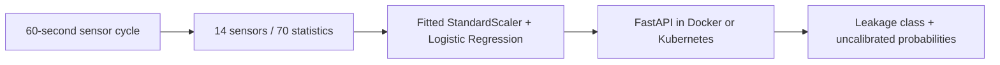
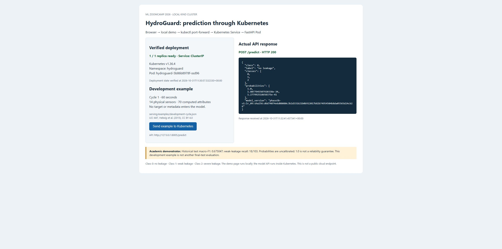

# HydroGuard — Industrial Hydraulic Pump Fault Diagnosis

HydroGuard is an academic demonstrator for maintenance engineers and ML peer
reviewers. It classifies internal hydraulic pump leakage as **no, weak or severe
leakage** from one 60-second sensor cycle. It is not validated for maintenance
release decisions, industrial control or safety use.

The UCI Condition Monitoring of Hydraulic Systems dataset contains 2,205 ordered
cycles and 17 signals from one controlled rig. Fourteen physical sensors contribute
five statistics each: 70 attributes. IDs, condition labels, target and stability
remain metadata. The selected model is a fitted StandardScaler/LogisticRegression
Pipeline. See [dataset specification and limitations](docs/dataset.md).



| Historical result | Value |
| --- | --- |
| Development CV macro-F1 used for selection | 0.837084 |
| Reserved-test macro-F1 | **0.675047** |
| Weak-leakage recall | **18/103 (0.174757)** |
| Severe-leakage recall | 103/103 |

Weak leakage is poorly detected. Prior test exposure during EDA, unverified
independence of configuration groups, the unvalidated gap-20 assumption, a single
rig and small unstable fault subgroups limit generalization. Probabilities are
uncalibrated; 1.0 is not a reliability guarantee. These are saved evaluation results.

## Choose what to check

| Goal | Follow | Tools needed after cloning |
| --- | --- | --- |
| Inspect the analysis and model choice | [Peer review map](#peer-review-map) | Browser; executed notebooks are committed |
| Run the saved model and send a prediction | [Docker service](#run-the-saved-api-with-docker) | Docker Desktop with Linux containers |
| Repeat EDA and fixed-model training | [ML reproduction](#reproduce-the-ml-workflow) | uv and internet access |
| Run automated checks | [Tests and quality checks](#run-tests-and-quality-checks) | uv |
| Reproduce Kubernetes deployment and browser demo | [Kubernetes guide](deploy/kubernetes/README.md) | Docker, kubectl, kind; uv for the local verification/demo clients |

These are separate review paths. Serving the saved model does not require a data
download or training. ML reproduction does not require Docker or Kubernetes.

## Get a fresh copy

Install [Git](https://git-scm.com/downloads), open a terminal in a parent folder of
your choice and run:

```text
git clone https://github.com/Stefancina9888/hydroguard.git hydroguard-review
cd hydroguard-review
git rev-parse HEAD
```

Use a different destination name if `hydroguard-review` already exists. For course
review, select the exact submitted commit with `git checkout` followed by the full
SHA from the submission. Git's detached-HEAD notice is normal for a selected commit.

**Run all remaining commands from this cloned repository root**, containing README.md,
Dockerfile, pyproject.toml and the scripts directory. In VS Code, open this cloned
folder before creating terminals. If an environment from another project is active,
run `deactivate` in that terminal first. `uv run` will select this copy's own `.venv`.

PowerShell is the tested Windows shell. The Git, Docker and uv commands also work
on Bash; HTTP request variants for both shells are shown below. No private data,
credentials or original author environment is required.

## Run the saved API with Docker

**Prerequisite:** install [Docker Desktop](https://docs.docker.com/desktop/), use
Linux containers, start it and wait until `docker info` succeeds.

### 1. Build and start

```text
docker build -t hydroguard:review .
docker run --rm --detach --name hydroguard-review --read-only --publish 127.0.0.1:8001:8000 hydroguard:review
```

The run command prints a container ID and returns to the prompt. Wait a few seconds
for model startup. No dataset or Python environment is needed on the host.

### 2. Check readiness and send the included example

Windows PowerShell:

```powershell
curl.exe --fail http://127.0.0.1:8001/health
curl.exe --fail -H "Content-Type: application/json" --data-binary "@serving/examples/development-cycle.json" http://127.0.0.1:8001/predict
```

Bash on Linux/macOS:

```bash
curl --fail http://127.0.0.1:8001/health
curl --fail -H "Content-Type: application/json" --data-binary "@serving/examples/development-cycle.json" http://127.0.0.1:8001/predict
```

Expected: `/health` returns `ready: true` and a model version. The prediction returns
`class: 0`, `label: "no leakage"`, `classes: [0, 1, 2]` and three probabilities.
The example is development cycle 1, already included with its
[provenance](serving/examples/provenance.json). There is no need to type sensor arrays.
Class 1 means weak leakage; class 2 means severe leakage. See the
[recorded full response](docs/prediction-demo.md) for comparison.

While the container is running, http://127.0.0.1:8001/docs shows the API schema.
To check rejection of a missing-sensor request, PowerShell users can run:

```powershell
curl.exe -i -H "Content-Type: application/json" --data-binary "{}" http://127.0.0.1:8001/predict
```

Expected: **HTTP 422**. On Bash, use `curl` instead of `curl.exe`.

### 3. Stop the container

After inspecting the response and API documentation:

```text
docker stop hydroguard-review
```

The container is removed automatically; the built image stays local. Actual checks
are recorded in [serving verification](docs/serving-verification.md).

## Reproduce the ML workflow

Install [uv](https://docs.astral.sh/uv/getting-started/installation/) and open a
terminal in the cloned root. Internet access is required for missing Python/packages
and the dataset. Allow several GB of disk space. The data download is about 74 MB.

### 1. Create the locked environment and download verified data

```text
uv sync --locked --group eda --python 3.11.15
uv run --locked python -c "import sys; print(sys.executable); print(sys.version.split()[0])"
uv run --locked python scripts/download_data.py
```

Expected: the Python path points inside **this clone's** `.venv`, version 3.11.15.
uv manages the environment and can obtain the requested Python; manual activation
is unnecessary. The downloader checks the pinned archive and extracted files.
It creates ignored local data under `data/raw`; raw data are not committed.

### 2. Execute both notebooks

```text
uv run --locked --group eda python scripts/run_notebooks.py
```

Expected: two PASS messages, **9 executed code cells in each notebook**. Open the
generated copies under `data/processed/executed-notebooks/` to inspect results.
The runner preserves the committed notebooks and writes separate executed copies.

`01_eda.ipynb` repeats descriptive exploration, including the historical all-cycle
EDA exposure. `02_modeling.ipynb` presents saved baseline comparisons, tuning and
test results, interprets coefficients, and actually reproduces one fit of the fixed
selected model on the 1,328 locked development cycles. Its new bundle goes under
`data/processed/reproductions/notebook-*`.

### 3. Run the standalone training script

```text
uv run --locked python scripts/reproduce_training.py --output data/processed/reproductions/review-1
```

Expected result fields:

```json
{
  "status": "completed",
  "training_cycles": 1328,
  "pipeline_fits": 1,
  "test_features_extracted": false,
  "test_predictions": false,
  "test_metrics": false,
  "official_artifacts_unchanged": true
}
```

This is a subset of the printed report. The new directory contains `manifest.json`,
the actual acquisition record `download.json`, `model/pipeline.pkl`,
`model/metadata.json` and `results.json`. It also reports whether the new model bytes
match the official model; they matched in the recorded Windows review runs.

The notebook and standalone script call the same fixed development reproduction;
running both performs two separate fits and saves separate outputs. Choose a new
output name, such as `review-2`, when intentionally repeating the standalone command.
Existing outputs are refused. The official serving bundle is not replaced.

This reproduces the chosen model's training, not the full historical tuning search
or final-test evaluation. Historical baseline/tuning/test reports remain available
in the peer review map. Fresh acquisition records have a new timestamp; use this
documented reproduction entry point. Original phase commands require the original
acquisition provenance and are retained in the historical reference, not as fresh
checkout instructions.

## Run tests and quality checks

After the ML environment setup above:

```text
uv run --locked pytest
uv sync --project serving --locked --no-editable --python 3.11.15
uv run --project serving --locked --no-editable pytest -c serving/pyproject.toml serving/tests
uv run --locked ruff check .
uv run --locked ruff format --check .
uv lock --check
uv lock --project serving --check
```

Expected: **304 project tests and 117 API tests pass**, Ruff checks pass and both
lock checks succeed. The serving environment is separate from the root environment.
For tests alone, the setup command is `uv sync --locked --python 3.11.15`; no data
download, notebook execution, real-model training or Docker is required.

The recorded notebook kernel TCP warning and Starlette/httpx TestClient deprecation
warning do not indicate failed execution. Treat tracebacks, failed tests or nonzero
command exits as failures and inspect the message before continuing.

## Kubernetes deployment and browser demo

Follow the complete [local Kubernetes guide](deploy/kubernetes/README.md), starting
with the already cloned project. It includes prerequisites, kind installation,
cluster creation, image loading, deployment, terminal-by-terminal port forwarding,
verification, browser interaction and cleanup. **No ML/data setup is needed to serve
the model in Kubernetes.**



The API runs in the Kubernetes Pod. The optional demo page runs on localhost and
sends the included request through the Service. Actual code and testing evidence
are in [Kubernetes verification](docs/kubernetes-verification.md). This is local
Kubernetes, not a public cloud endpoint. A single replica does not establish high
availability or improve model quality. Peer reviewers determine the course score.

## Troubleshooting

| Symptom | What to check |
| --- | --- |
| Wrong environment path or active-environment mismatch warning | Run `deactivate` for the other project, check the current folder and repeat this copy's uv setup. |
| Docker cannot connect | Start Docker Desktop in Linux-container mode; wait for `docker info` to succeed. |
| Connection refused immediately after Docker start | Allow a few seconds for startup; inspect `docker logs hydroguard-review` if it persists. |
| Port 8001 occupied | Use another host port, such as `127.0.0.1:8002:8000`, and change request/browser URLs to that port. |
| Container name already in use | Check `docker ps -a`; stop your earlier review container or select a different name. |
| Reproduction output already exists | Use a new directory below `data/processed/reproductions`, for example `review-2`. |
| Historical checksum mismatch | Use a fresh checkout of the submitted commit. Keep generated notebook outputs separate from committed historical files. |
| Browser requests `/favicon.ico` and gets 404 | The optional icon is absent; successful prediction requests still return HTTP 200. |

At the end of a clean review run, `git status --short` should print nothing: generated
data, environments and reports are ignored. Sixteen historical CRLF text files use
byte-preserving Git exceptions because their bytes are covered by stored checksums;
details are retained in [release readiness](docs/release-readiness.md).

## Peer review map

- Analysis: [EDA notebook](notebooks/01_eda.ipynb) and [EDA findings](docs/eda-findings.md)
- Modeling: [modeling notebook](notebooks/02_modeling.ipynb), [baselines](docs/baseline-results.md), [tuning](docs/tuning-results.md)
- Evaluation: [protocol](docs/validation-plan.md) and [final test](docs/final-test-results.md)
- Training script: [reproduce_training.py](scripts/reproduce_training.py)
- API: [FastAPI application](serving/src/hydroguard_serving/app.py)
- Deployment: [Kubernetes guide](deploy/kubernetes/README.md) and [actual evidence](docs/kubernetes-verification.md)
- Review: [criteria checklist](docs/requirements-checklist.md) and [project explanation](docs/project-walkthrough.md)
- Submission: [2026 submission guide](docs/submission-guide.md)
- Earlier execution evidence: [clean-copy run](docs/release-readiness.md), [submission verification](docs/submission-verification.md)
- Advanced reference: [historical phase commands and file map](docs/historical-workflow.md)

## Dataset attribution

Helwig, N., Pignanelli, E., & Schütze, A. (2015). *Condition monitoring of hydraulic
systems* [Dataset]. UCI Machine Learning Repository.
[DOI: 10.24432/C5CW21](https://doi.org/10.24432/C5CW21).
The data are licensed under [CC BY 4.0](https://creativecommons.org/licenses/by/4.0/).
That license is not a declaration of a source-code license for this repository.
