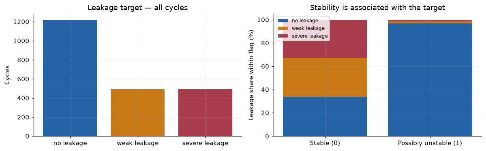
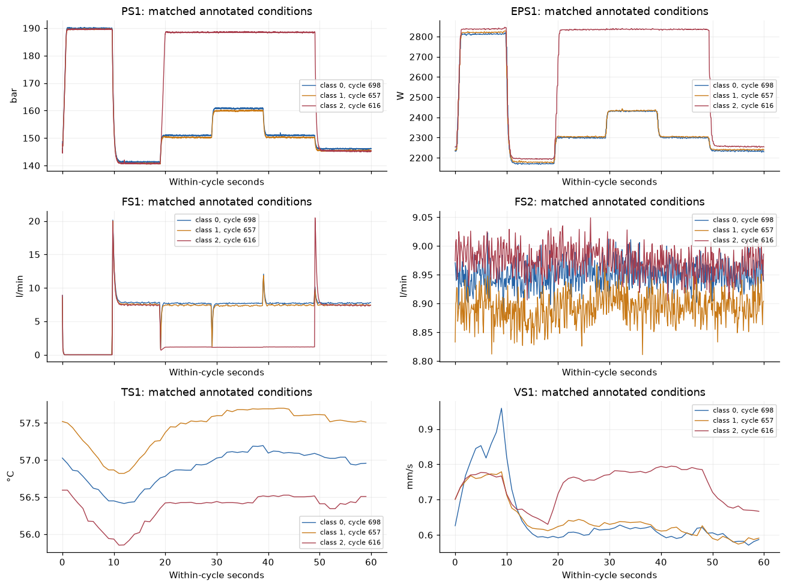
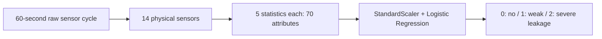
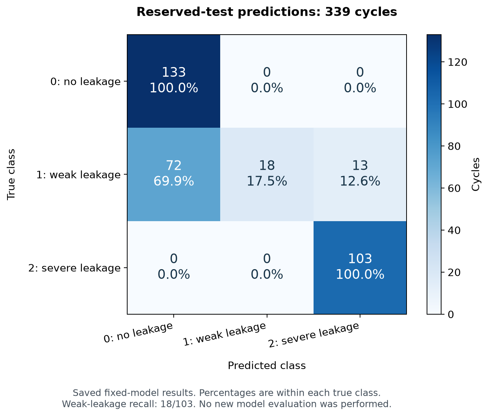

# HydroGuard — Industrial Hydraulic Pump Fault Diagnosis

HydroGuard investigates whether a 60-second cycle of industrial sensor measurements
can identify **internal hydraulic pump leakage**. It covers the complete ML workflow:
data validation, exploratory analysis, feature extraction, model comparison and
tuning, fixed-model evaluation, and a prediction service in Docker and Kubernetes.

**Main result:** the selected Logistic Regression model achieved a reserved-test
macro-F1 of **0.675047**, but detected only **18 of 103 weak-leakage cases**. The
application works end to end; the model remains an academic demonstrator with
limited diagnostic reliability.

[Problem and use](#problem-and-intended-use) · [Data](#dataset-and-prediction-target) ·
[Analysis](#what-the-exploration-showed) · [Models](#model-development) ·
[Results](#evaluation-and-results) · [Demo](#application-demonstration) ·
[Run it](#get-a-fresh-copy) · [Complete execution guide](docs/reproduce.md)

## Problem and intended use

The task is to distinguish no, weak and severe internal leakage from pressure,
power, flow, temperature and vibration measurements. In a maintenance-engineering
workflow, a sensor-based classification could provide an additional diagnostic
signal for a human to investigate. This project demonstrates that integration:
one measured cycle enters an API, and a saved model returns a leakage class and
ordered probabilities.

The target describes the pump condition during that measured cycle. The project
does not estimate remaining useful life or time until failure. Its intended users
are ML peer reviewers and maintenance engineers exploring the workflow, rather
than operators relying on it for maintenance release or industrial control.

## Dataset and prediction target

The [UCI Condition Monitoring of Hydraulic Systems dataset](https://archive.ics.uci.edu/dataset/447/condition+monitoring+of+hydraulic+systems)
contains **2,205 ordered, 60-second cycles from one controlled hydraulic test rig**.
The source has 17 signals; this project uses the 14 physical sensors below and
excludes the three virtual signals CE, CP and SE from prediction features.

| Physical sensors | Measurement | Sampling rate | Samples per cycle |
| --- | --- | ---: | ---: |
| PS1–PS6 | Pressure | 100 Hz | 6,000 |
| EPS1 | Motor power | 100 Hz | 6,000 |
| FS1–FS2 | Volume flow | 10 Hz | 600 |
| TS1–TS4 | Temperature | 1 Hz | 60 |
| VS1 | Vibration | 1 Hz | 60 |

Each cycle has one pump-leakage label. The full source dataset has:

| Class | Meaning | Cycles |
| --- | --- | ---: |
| 0 | No leakage | 1,221 |
| 1 | Weak leakage | 492 |
| 2 | Severe leakage | 492 |

The source also records cooler condition, valve condition, accumulator pressure
and a stability flag. Those labels, cycle IDs and the target remain metadata and
never enter the model input. The audit validates shapes, numeric values, profile
domains and source checksums; it rejects malformed rows rather than silently
imputing or truncating them. All source cycles are retained at the audit stage.
See [dataset specification](docs/dataset.md) and [executed audit](docs/dataset-audit.md).

## What the exploration showed

The EDA examined target balance, operating-condition associations, ordered sensor
changes, representative waveforms and similarity between neighboring cycles.
Two findings shaped the validation design:

- **Stability and target are associated.** The full dataset is imbalanced, and
  possibly unstable cycles are dominated by the no-leakage class. Excluding the
  stability flag from X does not remove the physical effects that sensors may carry.
- **Cycle order matters.** Adjacent cycles are much more similar than random
  nonadjacent cycles. In the inspected random stratified split, an average 95.24%
  of validation cycles had an immediate training neighbor. A simple shuffled row
  split would therefore be a weak basis for a generalization claim on this dataset.



The next figure shows six representative sensors over one full cycle, with one
example from each leakage class under matched annotated operating conditions.
It illustrates the raw input and the repeated load pattern. These three examples
do not establish causal sensor importance or general class separability; their
cycle positions and temperatures still differ.



Both images are exported from the existing executed [EDA notebook](notebooks/01_eda.ipynb).
See [EDA findings](docs/eda-findings.md) for measurements, selection of the illustrated
cycles and limitations.

## Model development

For each physical sensor, the shared extractor computes mean, population standard
deviation, RMS, minimum and maximum. This gives **14 × 5 = 70 deterministic numeric
attributes per cycle**. These summaries are simple and reproducible, but they do
not preserve the entire within-cycle waveform. Logistic Regression uses a fitted
StandardScaler inside its Pipeline; the scaler learns only from training rows.



A most-frequent Dummy baseline, Logistic Regression and Random Forest were evaluated
on the same three saved development folds. The bounded search evaluated **23
configurations in 69 fold fits**. LR varied C and class weighting; RF varied depth,
leaf size, feature sampling and class weighting. The primary selection criterion
was unweighted mean fold macro-F1, so each leakage class contributed to the score.

| Model | Baseline mean CV macro-F1 | Selected mean CV macro-F1 |
| --- | ---: | ---: |
| Most-frequent Dummy | 0.259311 | — |
| Logistic Regression | 0.786481 | 0.837084 |
| Random Forest | 0.781784 | 0.785987 |

**Selected model:** Logistic Regression `lr_09`, C=100 and class_weight=None, with
the complete fitted scaler/classifier Pipeline saved for inference. Its development
mean macro-F1 was higher than the selected RF's under the prespecified criterion.
These development scores were used for selection and may be optimistic; they are
not final-test results. Full candidates, parameters and fold details are in the
[baseline](docs/baseline-results.md) and [tuning](docs/tuning-results.md) reports.
The [modeling notebook](notebooks/02_modeling.ipynb) explains this process, executes
a separate fixed-model development reproduction and interprets LR coefficients.

## Evaluation and results

The saved split groups cooler/valve/accumulator configurations, then excludes
training candidates within 20 original cycle positions of held-out cycles.
It leaves **1,328 development, 339 reserved-test and 538 excluded cycles**.
Three inner development folds apply the same group/gap principle. The final
selected Pipeline was fitted on the retained development cohort and evaluated
on the reserved test before serving was added.

| Reserved-test metric | Value |
| --- | ---: |
| Macro-F1 | **0.675047** |
| Balanced accuracy | 0.724919 |
| No-leakage recall | 133/133 |
| Weak-leakage recall | **18/103 (17.48%)** |
| Severe-leakage recall | 103/103 |



The weak-leakage row explains the main failure: **72 weak cases were predicted as
no leakage and 13 as severe leakage**. The decline from development mean macro-F1
0.837084 to test macro-F1 0.675047 shows that the selected development score did not
carry over to the held-out configurations. Perfect severe recall in these 103
cases is not a reliability guarantee for future data.

The matrix visualizes existing saved counts; it is not another model evaluation.
All results and subgroup details are in [final-test results](docs/final-test-results.md).
The groups are not proven independent experiments, gap 20 is not a validated
decorrelation time, and the reserved test was previously exposed during EDA.
The [protocol](docs/validation-plan.md) documents those limits.

## Application demonstration

FastAPI loads the saved Pipeline once. Each POST /predict validates the sensor
vectors, computes the same 70 attributes, and returns a class, label, probabilities
in class order [0,1,2], and a model version. Docker includes the model and runtime;
Kubernetes runs that same API image behind a Service with health probes.


The included button sends **one fixed development example, cycle 1**, through the
running API each time. It demonstrates a real request/response and consistent
deployment behavior. Since that cycle was in development training, this demo is
not independent model-performance evidence. The 339-cycle results above provide
the saved evaluation evidence. Probabilities are uncalibrated; 1.0 is not certainty.

## Practical value and next work

The project delivers a functioning, reproducible sensor-to-service ML prototype.
It supports learning, peer review and experimentation with a diagnostic workflow.
Its current weak-leakage detection is insufficient for autonomous maintenance
decisions, and one rig does not establish performance on other machines.

Further work would require independent, representative evaluation data, investigation
of weak-leakage errors and a new development/evaluation plan for any feature or
model changes. Within-cycle or frequency features are possible research directions,
not demonstrated improvements. The existing test results were not used to retune
the submitted model. Deployment in Kubernetes changes delivery, not predictive quality.

## Get a fresh copy

With Git installed, open a terminal in a parent folder and run:

```text
git clone https://github.com/Stefancina9888/hydroguard.git hydroguard-review
cd hydroguard-review
```

Choose another destination name if that folder exists. For course review, select
the exact submitted SHA with `git checkout` followed by that SHA. Run the commands
below from the cloned root. The complete [execution guide](docs/reproduce.md)
includes prerequisites, expected outputs, environment checks and troubleshooting.

## Run the saved API with Docker

Start Docker Desktop in Linux-container mode and wait for `docker info` to succeed:

```text
docker build -t hydroguard:review .
docker run --rm --detach --name hydroguard-review --read-only --publish 127.0.0.1:8001:8000 hydroguard:review
```

After a few seconds, in PowerShell:

```powershell
curl.exe --fail http://127.0.0.1:8001/health
curl.exe --fail -H "Content-Type: application/json" --data-binary "@serving/examples/development-cycle.json" http://127.0.0.1:8001/predict
```

On Bash, use `curl` instead of `curl.exe`. Expected: ready=true, then class 0 and
label `no leakage`. The model and request are included; no dataset download or
training is needed. API documentation is at http://127.0.0.1:8001/docs. When finished:

```text
docker stop hydroguard-review
```

## Reproduce the ML workflow

Install [uv](https://docs.astral.sh/uv/getting-started/installation/), then:

```text
uv sync --locked --group eda --python 3.11.15
uv run --locked python scripts/download_data.py
uv run --locked --group eda python scripts/run_notebooks.py
uv run --locked python scripts/reproduce_training.py --output data/processed/reproductions/review-1
```

Expected: two executed notebooks with 9 code cells each, and a separate completed
training run using 1,328 development cycles. The notebook also executes one fixed
development reproduction. New outputs are Git-ignored; existing output directories
are refused, so use a new name for a repeat. The official serving bundle stays fixed.
This reproduces fixed-model training; historical tuning and test results are read
from saved reports. See [the full ML instructions](docs/reproduce.md#reproduce-the-ml-workflow).

## Tests and Kubernetes

The recorded checks pass **304 project tests + 117 API tests**, Ruff and both lock
checks. Follow [test commands](docs/reproduce.md#run-tests-and-quality-checks) to run
them locally. Tests alone require no dataset download or Docker.

For the additional deployment, follow the [Kubernetes guide](deploy/kubernetes/README.md)
from cluster setup through two-terminal verification, the browser demo and cleanup.
No ML training/data setup is needed for that path. The local kind implementation,
manifests and actual [verification evidence](docs/kubernetes-verification.md) support
the course's local-or-remote Kubernetes criterion. A final score is set by reviewers.

## Peer review map

- Data: [specification](docs/dataset.md), [audit](docs/dataset-audit.md), [EDA notebook](notebooks/01_eda.ipynb)
- Analysis: [EDA findings](docs/eda-findings.md), [modeling notebook](notebooks/02_modeling.ipynb)
- Modeling: [baselines](docs/baseline-results.md), [tuning](docs/tuning-results.md), [validation protocol](docs/validation-plan.md)
- Evaluation: [final test](docs/final-test-results.md)
- Execution: [complete guide](docs/reproduce.md), [training script](scripts/reproduce_training.py), [API](serving/src/hydroguard_serving/app.py)
- Deployment: [Kubernetes guide](deploy/kubernetes/README.md), [checks and screenshot](docs/kubernetes-verification.md)
- Review: [criteria checklist](docs/requirements-checklist.md), [project explanation](docs/project-walkthrough.md), [submission guide](docs/submission-guide.md)
- Earlier execution evidence: [clean-copy run](docs/release-readiness.md), [submission verification](docs/submission-verification.md)

The three analysis figures are exported/rendered from existing notebook outputs
and saved results. [Figure provenance](docs/images/readme-figures.json) records the
sources and hashes. They can be regenerated with
`uv run --locked --group eda python scripts/render_readme_figures.py` without
fitting or predicting. No other students' figures or implementation were copied.

## Dataset attribution

Helwig, N., Pignanelli, E., & Schütze, A. (2015). *Condition monitoring of hydraulic
systems* [Dataset]. UCI Machine Learning Repository.
[DOI: 10.24432/C5CW21](https://doi.org/10.24432/C5CW21).
Data are licensed under [CC BY 4.0](https://creativecommons.org/licenses/by/4.0/).
This is not a declaration of a source-code license for the repository.
