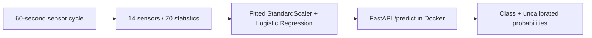

# HydroGuard — Industrial Hydraulic Pump Fault Diagnosis

HydroGuard is an **academic demonstrator for maintenance engineers and ML peer
reviewers**. It classifies internal hydraulic pump leakage as no, weak or severe
leakage from one 60-second sensor cycle. It illustrates how a reproducible ML
workflow can support a diagnostic discussion; it is not validated for maintenance
release decisions, industrial control or safety use.

The UCI Condition Monitoring of Hydraulic Systems dataset contains 2,205 ordered
cycles and 17 signals from one controlled rig. The fixed extractor uses 14 physical
sensors and five deterministic statistics each (70 attributes). Identifiers,
condition labels, target and stability remain metadata. The saved model is a
StandardScaler/LogisticRegression Pipeline, served locally by FastAPI and Docker.
See [dataset attribution and limitations](docs/dataset.md).



| Historical result | Value |
| --- | --- |
| Development CV macro-F1 used for selection | 0.837084 |
| Final reserved-test macro-F1 | **0.675047** |
| Weak-leakage recall | **18/103 (0.174757)** |
| Severe-leakage recall | 103/103 |

Weak leakage is poorly detected on the reserved test. Prior test exposure in EDA,
unverified independence of nuisance groups, an unvalidated gap-20 decorrelation
assumption, a single rig and small unstable fault subgroups limit generalization.
Probabilities are uncalibrated. These are frozen Phase 3B results, not new evaluations.

## Quick start — saved Docker service

Install Docker with Linux-container support and start its daemon. From this directory:

```text
docker build -t hydroguard:review .
docker run --rm --detach --name hydroguard-review --read-only --publish 127.0.0.1:8001:8000 hydroguard:review
```

In PowerShell (use `curl` instead of `curl.exe` on Bash):

```powershell
curl.exe --fail http://127.0.0.1:8001/health
curl.exe --fail -H "Content-Type: application/json" --data-binary "@serving/examples/development-cycle.json" http://127.0.0.1:8001/predict
docker stop hydroguard-review
```

Wait briefly for startup. `/docs` provides the interactive API schema. This path
needs no raw dataset, root Python environment or training reports; the image
contains only runtime code/dependencies and the official selected model bundle.
The example is development cycle 1. See the actual
[prediction demonstration](docs/prediction-demo.md),
[health screenshot](docs/images/local-api.png),
[serving checks](docs/serving-verification.md) and [clean-copy evidence](docs/release-readiness.md).
No cloud account or credentials are needed.

## Reproduce training separately — fresh acquisition

Install [uv](https://docs.astral.sh/uv/). From a clean checkout, run:

```text
uv sync --locked --group eda --python 3.11.15
uv run --locked python scripts/download_data.py
uv run --locked --group eda python scripts/run_notebooks.py
uv run --locked python scripts/reproduce_training.py --output data/processed/reproductions/review-1
uv run --locked pytest
uv sync --project serving --locked --no-editable --python 3.11.15
uv run --project serving --locked --no-editable pytest -c serving/pyproject.toml serving/tests
uv run --locked ruff check .
uv run --locked ruff format --check .
uv lock --check
uv lock --project serving --check
```

`uv run` selects the project virtual environment without manual activation.
Python 3.11.15 and numerical library versions match the official model metadata;
root `pyproject.toml`/`uv.lock` and the independent serving lock remain unchanged.
A new download transfers about 74 MB; allow several GB for expanded data, two
environments, notebook execution and Docker. Package/image download caches may
be reused; no existing dataset, local environment or OOF CSV is needed.

The new reproduction verifies the pinned archive and every raw file, retains the
new real `download.json`, reuses exactly 1,328 saved development IDs and the fixed
lr_09 parameters/70-feature extractor, and fits one complete Pipeline. A separate
manifest, acquisition record, bundle and result JSON go only to the **new** output
directory. Existing outputs are refused; choose a new name for an intentional new
run. No test features, predictions or metrics are produced. The official bundle
and all historical reports remain unchanged. This is not a new model selection run.

Historical locks include the original acquisition timestamp through the checksum
of `download.json`. Their original commands still enforce that exact record and
will reject a fresh acquisition. **Do not edit the new provenance to make those
commands pass.** Use `reproduce_training.py`, which permits only the provenance
record hash to differ after content/environment identity is established. The saved
Docker service continues to use the official model, not the reproduced bundle.

The notebook runner executes both notebooks in fresh kernels and writes separate
copies under `data/processed/executed-notebooks`; canonical historical notebook
bytes are preserved. `02_modeling.ipynb` explains the saved baseline/tuning/final
reports, performs one
separate reproduction fit on the locked development cohort, and describes the
official standardized LR coefficients. It never computes test features or predictions.
Each execution writes its reproduction to a new Git-ignored notebook-* directory;
the standalone training command above is an alternative entry point to the same fit.
Running both performs two separate development reproductions. The original
Phase 5 clean-copy report describes the earlier notebook; see the current
[submission verification](docs/submission-verification.md) for this revision.
Running both performs two separate development reproductions. The original
Phase 5 clean-copy report describes the earlier notebook; see the current
[submission verification](docs/submission-verification.md) for this revision.
`01_eda.ipynb` repeats the historical descriptive exploration, including its prior
all-cycle EDA exposure; it does not evaluate a model.

Optional clean-copy export, including uncommitted Git-eligible project files:

```text
uv run --locked python scripts/export_clean_copy.py --destination "../HydroGuard Phase5 Clean Review"
```

The exporter uses a temporary Git index with autocrlf enabled, leaves the real
index unchanged, and excludes raw data, environments, OOF tables and temporary
files. Already-LF/new text checks out as LF. Sixteen historical CRLF files are
explicit `-text` exceptions: converting them would change locked hashes. See
[release readiness](docs/release-readiness.md) for the historical LF-everywhere
constraint and actual command logs. The owner accepted the byte-preserving
exceptions before the initial publication; they do not require data or model changes.

## Peer review map

- [EDA notebook](notebooks/01_eda.ipynb) and [modeling notebook](notebooks/02_modeling.ipynb)
- [Locked protocol](docs/validation-plan.md), [baselines](docs/baseline-results.md), [tuning](docs/tuning-results.md), [final test](docs/final-test-results.md)
- [Official-criteria checklist](docs/requirements-checklist.md) and [clean-copy results](docs/release-readiness.md)
- Training: `scripts/reproduce_training.py`; API: `serving/src/hydroguard_serving/app.py`
- [Project explanation and design decisions](docs/project-walkthrough.md)
- [2026 submission checklist and deadlines](docs/submission-guide.md)
- [Historical phase commands and full file map](docs/historical-workflow.md)

AI assistance: Codex helped implement, document and verify this project under the
owner's phase-by-phase instructions. No code was copied from other students' projects.
The owner remains responsible for reviewing the implementation and course rules.

## Dataset attribution

Helwig, N., Pignanelli, E., & Schütze, A. (2015). *Condition monitoring of hydraulic
systems* [Dataset]. UCI Machine Learning Repository.
[DOI: 10.24432/C5CW21](https://doi.org/10.24432/C5CW21).
The dataset is licensed under [CC BY 4.0](https://creativecommons.org/licenses/by/4.0/).
The dataset license applies to the data; it is not a declaration of a source-code
license for this repository.
