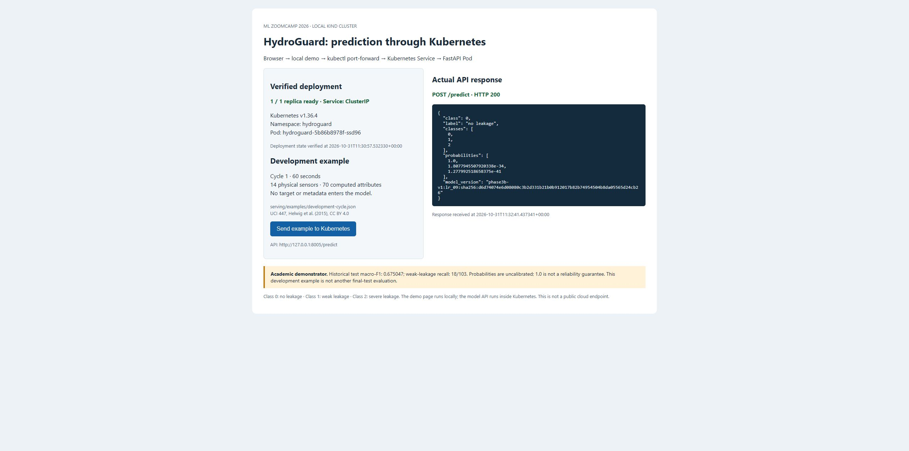

# Actual local Kubernetes deployment verification

The official saved HydroGuard model was deployed to **kind v0.33.0 / Kubernetes
v1.36.4** on 31 October 2026. The same existing Dockerfile and model were used.
This is an actual local Kubernetes run, not a public cloud deployment.

## Code and reproduction

- [Pinned cluster configuration](../deploy/kubernetes/kind.yaml)
- [Namespace, Deployment and Service](../deploy/kubernetes/hydroguard.yaml)
- [Tested setup, requests and cleanup](../deploy/kubernetes/README.md)
- [Executable API/cluster checks](../scripts/verify_kubernetes.py)
- [Optional local browser client](../scripts/kubernetes_demo.py)
- [Machine-readable evidence](kubernetes-verification.json)

The Windows kind binary was downloaded from the official release and its SHA-256
verified. The node image is pinned by digest. The application image was built from
the unchanged project Dockerfile and loaded into the dedicated hydroguard-midterm
cluster. Its separate Git-ignored kubeconfig was used explicitly on every kubectl
command; no existing global context was changed.

## Actual outcomes

| Check | Result |
| --- | --- |
| Kubernetes Deployment | 1/1 ready replica |
| Pod | Running, container ready, 0 restarts at capture |
| Service | ClusterIP, port 8000, ready EndpointSlice endpoint |
| Manifest validation | Server-side dry run passed |
| Startup/readiness/liveness | HTTP /health probes configured; Pod reached Ready |
| GET /health through Service port-forward | HTTP 200, ready=true, official model version |
| POST /predict, development cycle 1 | HTTP 200, class 0, no leakage |
| Agreement with recorded direct prediction | Maximum probability difference 0.0 |
| Missing sensors / mixed boolean / wrong length / extra metadata | HTTP 422 in all four cases |
| Protected historical bytes | 72/72 unchanged |
| Project/API tests | 304 + 117 = 421 passed, no failures |
| Ruff and both uv lock checks | Passed |

The Pod runs as UID/GID 10001 with a read-only filesystem, no service-account token
mount, dropped capabilities, and CPU/memory requests and limits. No dataset was
mounted. There was no new real-dataset model training, selection, feature change
or final-test model evaluation. Existing tests use their normal synthetic fixtures.
The Starlette/httpx TestClient deprecation warning remains; actual HTTP checks passed.

## Actual browser interaction

The screenshot is an unmodified Chrome capture of the local browser client's
response page after clicking **Send example to Kubernetes**. The client sent the
checked-in development request to http://127.0.0.1:8005/predict through kubectl
port-forward to the Kubernetes Service. It displays the real HTTP 200 response,
official model version and uncalibrated probabilities. Deployment details show the
verification timestamp rather than continuous monitoring. The client itself runs
on the host; FastAPI and the model run inside the Kubernetes Pod.

## Rubric and limitations

The [official rubric](https://github.com/DataTalksClub/machine-learning-zoomcamp/blob/main/projects/README.md)
allows local or remote Kubernetes for the cloud/Kubernetes category. This revision
supplies deployment code, reproducible instructions and a screenshot of actual
testing, supporting that category's two points. Peer reviewers determine the score;
16/16 is a target, not a guaranteed result.

The deployment remains a one-node, one-replica academic demonstration. There is no
public URL, production traffic handling or high-availability claim. Historical test
macro-F1 remains 0.675047 and weak-leakage recall 18/103. Kubernetes does not improve
model quality or resolve the earlier EDA exposure, group/gap assumptions or single-rig
generalization limits. Earlier release/submission-verification records describe
their preceding revisions; this is the current Kubernetes deployment record.

See the machine-readable record for final cleanup status. The documented cleanup
stops local clients/port-forward and removes only the dedicated HydroGuard cluster.
The image and downloaded tools may remain locally for another review run.
