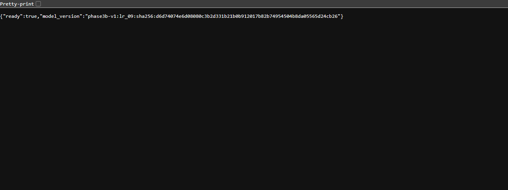

# Actual local prediction demonstration

This is the recorded result of a real HTTP request to the official saved model in
a running, read-only Docker container. The [JSON evidence](prediction-demo.json)
records the capture time, request checksum, image ID and responses. The temporary
capture harness is not a new API feature or a different prediction implementation.

## Reproduce the interaction

From the repository root, with Docker running:

```text
docker build -t hydroguard:review .
docker run --rm --detach --name hydroguard-review --read-only --publish 127.0.0.1:8001:8000 hydroguard:review
```

In PowerShell (use curl instead of curl.exe on Bash):

```powershell
curl.exe --fail http://127.0.0.1:8001/health
curl.exe --fail -H "Content-Type: application/json" --data-binary "@serving/examples/development-cycle.json" http://127.0.0.1:8001/predict
docker stop hydroguard-review
```

Wait briefly for service startup before sending the request. The checked-in file
contains 14 raw sensor vectors from **development cycle 1**, totaling 565,495 bytes.
The metadata and target are not sent. [Provenance](../serving/examples/provenance.json)
attributes UCI 447 (Helwig et al., 2015, CC BY 4.0) and records exact request bytes.
The capture used port 8003; the commands above use the README's port 8001.

## Actual response: HTTP 200

```json
{
  "class": 0,
  "label": "no leakage",
  "classes": [
    0,
    1,
    2
  ],
  "probabilities": [
    1.0,
    1.8077945507920338e-34,
    1.277992518658375e-41
  ],
  "model_version": "phase3b-v1:lr_09:sha256:d6d74074e6d08080c3b2d331b21b0b912017b82b74954504b8da05565d24cb26"
}
```

Interpretation: class 0 means **no leakage**, class 1 weak leakage, class 2 severe
leakage. `probabilities` follow the explicit `classes` order [0, 1, 2]. The class
and probabilities match the recorded direct Python prediction exactly.
`model_version` identifies the fixed saved Pipeline. A reported probability of 1.0
is a numerical model output, not calibrated certainty or a reliability guarantee.

The same run verified HTTP 200 and ready=true from GET /health. Replacing the first
PS1 numeric sample with a boolean returned HTTP 422 without echoing sensor arrays;
see the complete rejection in the JSON evidence.

## Deployment image and limitations



This existing image shows the earlier actual container health response. It is not
a new screenshot of this POST. Automatic browser capture for the new POST was
stopped because the Windows tool could not reliably establish the current browser
URL; no replacement screenshot is fabricated. The new POST evidence above comes
from the real recorded HTTP exchange.

This is a development example, not another test evaluation. Historical test
macro-F1 remains **0.675047**, with weak-leakage recall **18/103**. No new training
occurred during this API demonstration. The model remains an academic demonstrator;
the output must not be treated as a maintenance or industrial safety decision.
