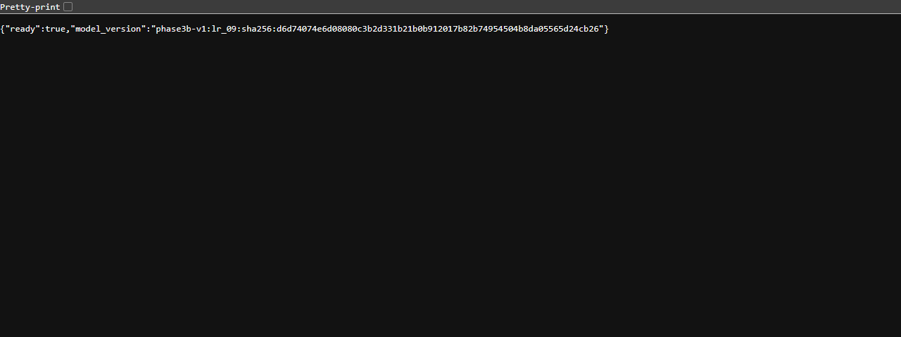

# Phase 5 — clean-copy reproduction and peer-review readiness

**Core reproduction and serving checks passed. One explicit requirement conflict remains: historical CRLF checksum files cannot also become LF without changing their frozen bytes.**

Actual run: 2026-10-30T23:43:54.875059+00:00 to 2026-10-30T23:45:42.273918+00:00 (UTC; 2026-10-31 in Europe/Belgrade).

## What was reproduced

A separate Git-filtered copy was exported with a temporary index and `core.autocrlf=true`. It initially had no root/serving .venv, raw/processed data, local OOF CSVs, .git directory or temporary files. Dependencies were installed into two newly created environments. Global package and Docker caches were available: this is a clean project-state reproduction, not an empty machine or an offline installation. No GitHub repository, commit or push was created; the real Git index stayed unchanged.

Clean-copy path: `C:\Users\iTC\Documents\HydroGuard Phase5 Clean Review`. Raw archive was freshly downloaded from official UCI, not copied from the original workspace. The ZIP contained 20 files and transferred 76,601,704 bytes.

Fresh acquisition UTC: `2026-10-30T23:44:04.718463+00:00`. Archive SHA-256: `24128aad2ee45eea7e6b63ebbd9992cdf25d0483a2cebefbfc13bc69079af1f2`. The unchanged strict acquisition/audit loader verified the archive pin, archive-derived per-file manifest, every extracted file, shapes, numeric validity and profile. Raw source rows and cycle IDs were retained.

## Provenance obstacle and its resolution

Historical split/experiment checks bind to the original download.json bytes, including acquisition time. A fresh identical ZIP has a truthful new timestamp and therefore a different acquisition-record checksum. Step 5 deliberately called the original input guard and observed its expected rejection; that guard was not relaxed or changed.

Original provenance SHA-256: `26483247d37ba2c9d2e298b6d731c0932ed5bc2e6c62984a14394e3ad436d0a9`. Fresh provenance SHA-256: `19c7698bbd87f6062b915c723d01aa0d2a790dbf2974414d7d1a97785b48c6c2`.

`src/hydroguard/reproduction.py` is a separate entry point. It verifies all frozen review files, requires equality of every historical content/environment fingerprint except the acquisition-record hash, checks the same saved outer/inner memberships without making a new split, and preregisters the fixed lr_09/70-feature development fit in a new directory. The new real acquisition JSON is retained unchanged. Archive/file/lock/config changes are rejected; the original timestamp is never forged.

The output is `data/processed/reproductions/review-1` inside the clean copy. It contains download.json, manifest.json, model/pipeline.pkl, model/metadata.json and results.json. The manifest exists before fitting. Existing output directories, official model/report paths and paths outside the reproduction area are refused. A failed run leaves its separate attempt directory for investigation; it does not replace history.

Actual fit: **1328 development cycles**, classes **846/246/236**, **1 Pipeline fit**, 0.125158 seconds of fit time. StandardScaler observed only the development cohort. There were 0 fit warnings. All 538 outer-excluded cycles remained out. Test attributes/predictions/metrics: **none**.

Reproduced model SHA-256: `d6d74074e6d08080c3b2d331b21b0b912017b82b74954504b8da05565d24cb26`. It is **byte-identical to the official saved Pipeline** in this execution. Predictions and predict_proba before/after loading were exactly equal on all 1,328 development rows; maximum difference was 0.0. This equality check used no reserved-test rows.

The portable bundle keeps the historical inference schema (phase=3B) for compatibility, while reproduction_phase=5, artifact_role and the separate reproduction manifest identify its non-official role. The API remains pinned to the official bundle; this output is not substituted into serving.

## Notebook execution and coefficient interpretation

Both notebooks executed in fresh kernels from the clean copy: **01_eda: 9 code cells; 02_modeling: 7 code cells**, with no cell errors. Outputs went to data/processed/executed-notebooks so canonical historical notebook bytes were preserved. The new canonical 02_modeling notebook contains its actual clean-run outputs. Local EDA summaries are disposable generated outputs; no historical report was replaced.

02_modeling reads saved baseline results, all 23 tuning candidates and the preregistered selection rule, then displays the existing final test metrics separately. It does not rerun CV, tuning, training or the test. Shared modules supply the extractor contract, frozen evidence and coefficient table instead of duplicating modeling algorithms.

All 210 standardized multinomial LR coefficients are displayed, with five largest absolute coefficients per class plotted only for readability. For example, PS1__max has coefficient +11.604359 for class 0 and -9.432671 for class 2. Mean/RMS/extrema and related sensor signals can be correlated, so coefficients are conditional class-logit effects, not causal importance or stable feature rankings. No feature or model was selected from this description.

## Actual command record

Full argument arrays, working directories, timings, statuses and hashes are in [release-readiness.json](release-readiness.json). Full stdout/stderr below are published with LF line endings; local original log hashes are also retained in JSON. Python -c helper bodies are recorded in full in JSON.

| Step | Command | Exit | Seconds | Output |
| --- | --- | --- | --- | --- |
| 1 | `uv run --locked python scripts/export_clean_copy.py --destination "C:\Users\iTC\Documents\HydroGuard Phase5 Clean Review"` | 0 | 0.277 | [log 01](release-evidence/01.txt) |
| 2 | `uv sync --locked --group eda --python 3.11.15` | 0 | 3.566 | [log 02](release-evidence/02.txt) |
| 3 | `uv run --locked python scripts/download_data.py` | 0 | 8.842 | [log 03](release-evidence/03.txt) |
| 4 | `uv run --locked --group eda python scripts/run_notebooks.py` | 0 | 34.317 | [log 04](release-evidence/04.txt) |
| 5 | `uv run --locked python -c <recorded verification helper>` | 0 | 1.472 | [log 05](release-evidence/05.txt) |
| 6 | `uv run --locked python scripts/reproduce_training.py --output data/processed/reproductions/review-1` | 0 | 16.501 | [log 06](release-evidence/06.txt) |
| 7 | `uv run --locked pytest --junitxml=data/processed/review-tests.xml` | 0 | 20.220 | [log 07](release-evidence/07.txt) |
| 8 | `uv sync --project serving --locked --no-editable --python 3.11.15` | 0 | 1.689 | [log 08](release-evidence/08.txt) |
| 9 | `uv run --project serving --locked --no-editable pytest -c <recorded verification helper>` | 0 | 8.949 | [log 09](release-evidence/09.txt) |
| 10 | `uv run --locked ruff check .` | 0 | 0.101 | [log 10](release-evidence/10.txt) |
| 11 | `uv run --locked ruff format --check .` | 0 | 0.075 | [log 11](release-evidence/11.txt) |
| 12 | `uv run --project serving --locked --no-editable ruff check serving` | 0 | 0.048 | [log 12](release-evidence/12.txt) |
| 13 | `uv run --project serving --locked --no-editable ruff format --check serving` | 0 | 0.044 | [log 13](release-evidence/13.txt) |
| 14 | `uv lock --check` | 0 | 0.019 | [log 14](release-evidence/14.txt) |
| 15 | `uv lock --project serving --check` | 0 | 0.018 | [log 15](release-evidence/15.txt) |
| 16 | `docker build --progress=plain -t hydroguard:phase5-review .` | 0 | 5.225 | [log 16](release-evidence/16.txt) |
| 17 | `docker image inspect --format {{.Id}} hydroguard:phase5-review` | 0 | 0.062 | [log 17](release-evidence/17.txt) |
| 18 | `docker run --rm --detach --name hydroguard-phase5-review --read-only --publish 127.0.0.1:8002:8000 hydroguard:phase5-review` | 0 | 0.308 | [log 18](release-evidence/18.txt) |
| 19 | `uv run --project serving --locked --no-editable python -c <recorded verification helper>` | 0 | 3.703 | [log 19](release-evidence/19.txt) |

## Tests, environment and Docker

**304 project tests and 117 API tests passed: 421 total, 0 failures, 0 errors and 0 skipped.** Root/serving Ruff lint and format checks and both uv lock checks passed. Neither root pyproject.toml/uv.lock nor the existing serving lock changed. Python 3.11.15, NumPy 2.4.6, pandas 2.3.3, scikit-learn 1.9.1, SciPy 1.17.1 and threadpoolctl 3.7.0 match the model metadata.

Actual clean-copy Docker build passed. Image ID: `sha256:057d6a55277783b397adfdcae4232155816bf3f2096054600fe92bdb5a82e64b`. The read-only localhost container reached Docker HEALTHCHECK status **healthy**. GET /health and POST /predict returned 200; mixed boolean samples, extra metadata and a missing sensor each returned 422 without arrays in error responses. The development-cycle prediction was class 0, no leakage, with classes [0,1,2]. Direct and container probabilities were exactly equal, maximum difference **0.0**. No raw data or training artifacts were mounted. The container was stopped and automatic removal verified after the screenshot. The local image remains available.

## Actual deployment screenshot

This unmodified PNG was rendered by the installed headless Google Chrome against http://127.0.0.1:8002/health while the clean-copy Docker container was running. It shows ready=true and the official model version. The corresponding actual POST prediction is recorded in release-readiness.json and log 19. This is localhost evidence, not a public/cloud deployment. Native Windows UI capture had unavailable geometry/incorrect visible content and the browser-access host was unavailable; no screenshot was fabricated to replace those failures.

PNG SHA-256: `c0956ecbfcde551c5b857350df6a8b5c616a790c56b41403b7606a46cd97b860`. Capture command and URL are in the JSON record.

## Historical integrity, Git inclusion and LF exception

**72 historical files are byte-identical in both original and clean directories**, including manifests, reports, protected source, both environment locks and the official model. Original baseline/tuning OOF CSV hashes also remain unchanged, while those ignored local files were absent from the clean copy. The new release records and outputs use separate paths.

The export included the official pipeline.pkl/metadata.json, serving lock and Python version, development request/provenance, both notebooks, feature/experiment locks, scripts and reports. Raw/processed data, environments, caches, browser profiles and temporary reproduction runs are Git-ignored. [git-preparation.json](git-preparation.json) records the final inclusion/exclusion check. Files are Git-eligible; the real index was intentionally not staged and nothing is committed yet.

**Unresolved literal LF requirement:** sixteen historical text files already have CRLF bytes inside checksum locks. Converting them to LF would invalidate the very history the task requires preserving. `.gitattributes` forces LF for new/already-LF text and uses explicit `-text` exceptions for the files below, plus binary model/image files. Actual autocrlf-enabled Git checkout preserved all 72 historical hashes. No digest, split lock, source file or official result was edited to hide this conflict. Full LF checkout everywhere would require separately authorized history migration; it is not claimed here.

- `artifacts/experiments/phase3a-v1.json`
- `artifacts/experiments/phase3b-test-access-v1.json`
- `artifacts/experiments/phase3b-training-attempt-v1.json`
- `artifacts/experiments/phase3b-v1.json`
- `artifacts/splits/phase2b-v1.json`
- `config/tuning-v1.json`
- `docs/baseline-results.md`
- `docs/eda-findings.md`
- `docs/final-test-results.md`
- `docs/phase-1a-clean-check.json`
- `docs/tuning-results.md`
- `docs/validation-plan.md`
- `docs/serving-verification.json`
- `docs/serving-verification.md`
- `serving/historical-checksums.json`
- `serving/src/hydroguard_serving/model-contract.json`

## Warnings, remaining limitations and publication steps

The fresh notebook kernel emits a local TCP transport encryption warning, and Starlette TestClient emits one httpx adapter deprecation warning. They are retained in logs; execution and actual Uvicorn/Docker HTTP checks succeeded. The original exact-provenance rejection is an intentional demonstrated check, not an unresolved training failure. Initial authoring lint findings were fixed before the clean export; all clean-run quality checks passed.

The academic limitations remain: historical final-test macro-F1 **0.675047**, weak-leakage recall **18/103**, prior EDA exposure of the test, unverified group independence/gap decorrelation, a single controlled rig, tiny unstable fault groups and uncalibrated probabilities. No new test evaluation or model/protocol adjustment occurred.

Before publication/submission, the owner should:

1. Review this change and accept the byte-preserving CRLF exceptions or separately authorize an explicit historical-format migration.
2. Review the complete Git-eligible file inventory, notebook outputs, model/provenance and screenshot; stage the intended project files.
3. Create the project GitHub repository, make the reviewed commit and push only when authorized. None of these actions was performed here.
4. Submit the repository URL and exact commit hash through the current course submission process; verify cohort deadlines there. No submission was performed.
5. Complete the three required peer reviews. Cloud deployment is optional bonus work and remains absent; no cloud points are claimed.

The current official rubric source and repository evidence are mapped in [requirements-checklist.md](requirements-checklist.md). Stop here for owner review.
